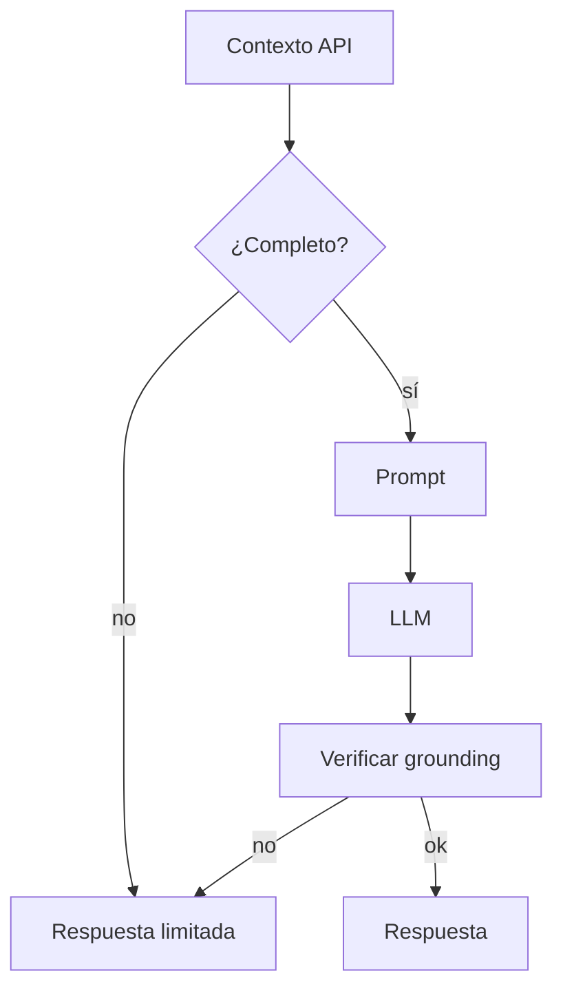
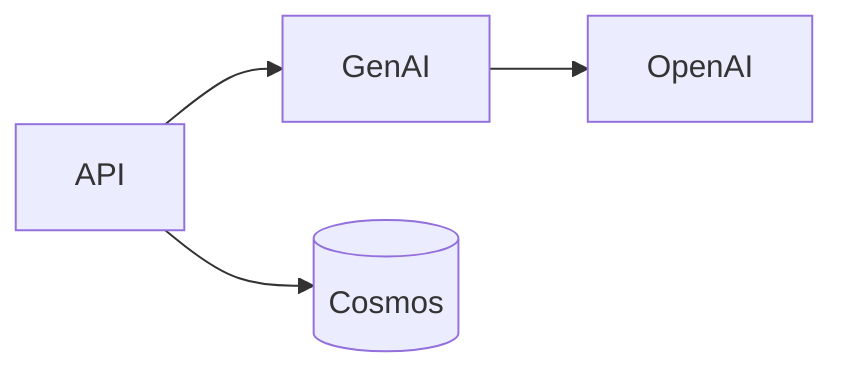
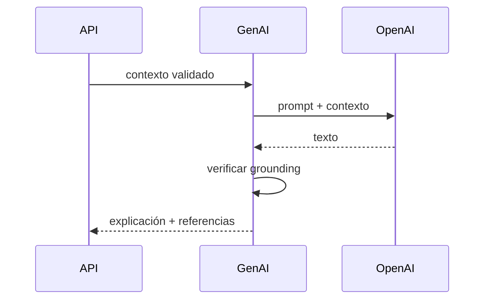

# Diagramas — Contratos y grounding de datos validados

> Spec: `spec.md` · Plan: `plan.md`. Diagramas Mermaid; no representan recursos desplegados.

## 1. Flujo funcional

## 2. Relación entre componentes

## 3. Flujo de datos / secuencia

## 4. Notas

No hay implementación ni llamadas a OpenAI activas.
