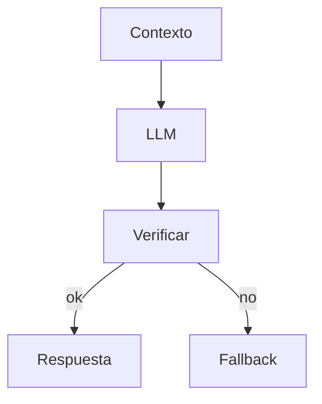
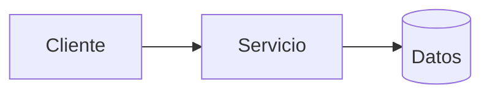
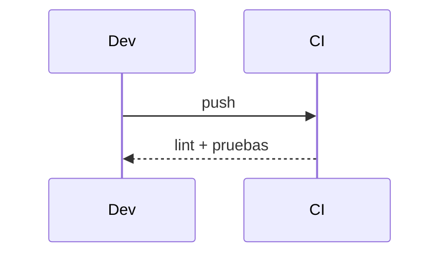

# Diagramas — 04-grounding-de-recomendaciones — Grounding de recomendaciones

> Spec: `spec.md` · Plan: `plan.md`.

## 1. Flujo funcional

## 2. Componentes

## 3. Secuencia

## 4. Notas

Diagramas de proceso; no representan recursos desplegados.
