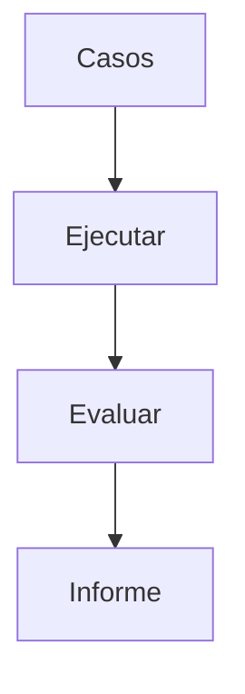
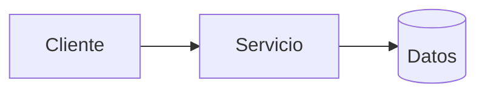
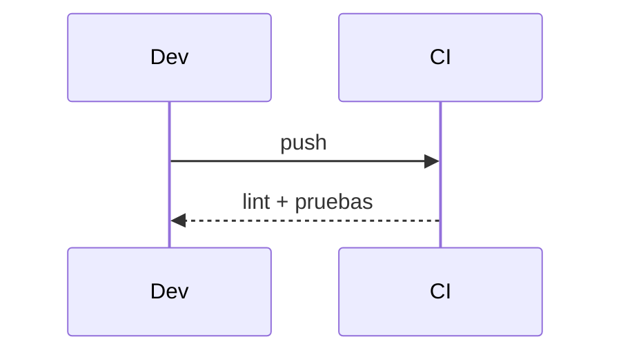

# Diagramas — 12-evaluacion-de-no-alucinacion — Evaluación de no alucinación

> Spec: `spec.md` · Plan: `plan.md`.

## 1. Flujo funcional

## 2. Componentes

## 3. Secuencia

## 4. Notas

Diagramas de proceso; no representan recursos desplegados.
